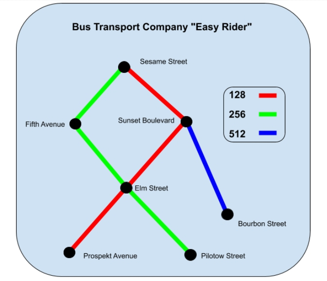

<h1 align="center">🚌 Easy Rider Bus Company</h1>

<p align="center"><em>Ta base de lignes de bus contient des erreurs ? Easy Rider les repère avant tes passagers.</em></p>

<p align="center">
  
  
  
</p>

---

## ✨ Pourquoi tu vas l'adorer

- **Contrôle qualité** : vérifie le type et le format de chaque champ (identifiants, noms d'arrêts, heures `HH:MM`).
- **Analyse du réseau** : nombre d'arrêts par ligne, terminus de départ et d'arrivée, correspondances.
- **Contrôle des horaires** : sur chaque ligne, les heures doivent être croissantes.

## 🗺️ Le réseau



## 📥 Format des données

Le programme lit **une seule ligne JSON**, qui contient la liste des arrêts. Chaque arrêt est un objet :

```json
{"bus_id": 128, "stop_id": 1, "stop_name": "Prospekt Avenue", "next_stop": 3, "stop_type": "S", "a_time": "08:12"}
```

| Champ | Rôle |
|---|---|
| `bus_id` | Numéro de la ligne |
| `stop_id` | Identifiant de l'arrêt |
| `stop_name` | Nom en deux mots, finissant par `Road`, `Avenue`, `Boulevard` ou `Street` |
| `next_stop` | Identifiant de l'arrêt suivant (`0` pour le dernier) |
| `stop_type` | `S` départ, `O` arrêt à la demande, `F` terminus d'arrivée, vide pour un arrêt intermédiaire |
| `a_time` | Heure d'arrivée au format `HH:MM` |

## 🚀 Lancer

```bash
python3 Code_Python_Easy_Rider_Bus_Company < donnees.json
```

## 🕹️ Exemple de sortie

<details>
<summary>📄 Voir la base de démonstration (une seule ligne)</summary>

```json
[{"bus_id": 128, "stop_id": 1, "stop_name": "Prospekt Avenue", "next_stop": 3, "stop_type": "S", "a_time": "08:12"}, {"bus_id": 128, "stop_id": 3, "stop_name": "Elm Street", "next_stop": 5, "stop_type": "O", "a_time": "08:19"}, {"bus_id": 128, "stop_id": 5, "stop_name": "Fifth Avenue", "next_stop": 7, "stop_type": "O", "a_time": "08:25"}, {"bus_id": 128, "stop_id": 7, "stop_name": "Sesame Street", "next_stop": 0, "stop_type": "F", "a_time": "08:37"}, {"bus_id": 256, "stop_id": 2, "stop_name": "Pilotow Street", "next_stop": 3, "stop_type": "S", "a_time": "09:20"}, {"bus_id": 256, "stop_id": 3, "stop_name": "Elm Street", "next_stop": 6, "stop_type": "", "a_time": "09:45"}, {"bus_id": 256, "stop_id": 6, "stop_name": "Sunset Boulevard", "next_stop": 7, "stop_type": "O", "a_time": "09:59"}, {"bus_id": 256, "stop_id": 7, "stop_name": "Sesame Street", "next_stop": 0, "stop_type": "F", "a_time": "10:12"}, {"bus_id": 512, "stop_id": 4, "stop_name": "Bourbon Street", "next_stop": 6, "stop_type": "S", "a_time": "08:13"}, {"bus_id": 512, "stop_id": 6, "stop_name": "Sunset Boulevard", "next_stop": 0, "stop_type": "F", "a_time": "08:16"}]
```

</details>

Résultat :

```text
Type and required field validation: 0 errors
bus_id: 0
stop_id: 0
stop_name: 0
next_stop: 0
stop_type: 0
a_time: 0
Line names and number of stops:
bus_id: 128, stops: 4
bus_id: 256, stops: 4
bus_id: 512, stops: 2
On demand stops test:
Wrong stop type: ['Elm Street', 'Sunset Boulevard']
Arrival time test:
OK
Start stops: 3 ['Bourbon Street', 'Pilotow Street', 'Prospekt Avenue']
Transfer stops: 3 ['Elm Street', 'Sesame Street', 'Sunset Boulevard']
Finish stops: 2 ['Sesame Street', 'Sunset Boulevard']
```

Ici, le test des arrêts à la demande signale deux arrêts `O` qui servent aussi de correspondance ou de terminus : c'est exactement ce que le validateur est là pour attraper.

## 🧠 Sous le capot

- `json.loads()` transforme le texte en objets Python.
- Des expressions régulières (`re.match`) valident les noms d'arrêts et les heures.
- `datetime.strptime()` convertit les heures pour vérifier qu'elles se suivent.

## 🔭 Pistes d'évolution

- Afficher le détail de chaque erreur (ligne et arrêt concernés), pas seulement leur nombre.
- Exporter le rapport dans un fichier.

---

<p align="center"><sub>Fait avec ❤️ et Python par DSKarim</sub></p>
